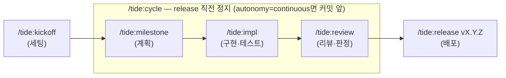

# tide

tide는 마일스톤 → 구현 → 리뷰 → 릴리즈로 이어지는 개발 사이클을 Claude Code 슬래시 커맨드로 구현한
워크플로우 모음입니다. 프로젝트에 독립적으로 만들어져 있어 어떤 저장소에든 얹어 쓸 수 있습니다.
해당 저장소에도 같은 개발 리듬과 문서화 규율을 그대로 적용할 수 있습니다. 또한 커맨드와 규약은 1.0부터
안정(stable) 상태이므로, 얹어 둔 사이클이 버전을 따라가며 흔들리지 않습니다.

`/tide:cycle`은 `milestone → impl → review`를 한 번에 이어서 실행합니다. 대신 git 작업을 하는
`release`는 자동 체이닝에서 빼 두었고, 그 직전에 멈춰 다음 단계를 안내하도록 되어 있습니다.
추가로 `/tide:status`를 쓰시면 언제든 현재 위치와 다음 커맨드를 읽기 전용으로 확인할 수 있습니다.

## 핵심 가치

tide가 지키는 원칙은 아래와 같습니다.

- 부수효과 분리: `impl`·`review`는 절대 git 작업을 하지 않고 코드와 보고서만 남깁니다. git commit/tag/push는
  오직 `release`에서만 일어납니다. 이 분리가 있어 의도치 않은 커밋이 사이클 중간에 끼어들지 않습니다.
- hook으로 기계적 강제: 프롬프트 지시에 더해 tide-guard hook이 `.tide/phase` 상태를 확인합니다.
  해당 상태가 `release`가 아닌 동안에는 git commit/tag/push를 차단합니다. 다만
  **상태 파일이 아직 없는 구간(fresh clone 직후)에는 보호가 없습니다.** 해당 창은 phase가 실제로 기록될 때
  닫히며, 상세는 [개념](concepts.md)에 정리되어 있습니다.
- 프로젝트 독립성: 특정 언어나 스택에 묶이지 않습니다. 버전 파일도 `Cargo.toml`·`package.json`·
  `pyproject.toml` 등 스택에 맞춰 다룹니다.
- 문서화 규율: 마일스톤·완료보고서·리뷰보고서·회고가 정해진 형식으로 남습니다. 이 기록이 있어
  사이클이 쌓일수록 의사결정 이력을 추적할 수 있습니다.

## 시작하기

더 자세한 내용은 아래 문서에 정리되어 있습니다.

- 설치와 첫 사이클은 [시작하기](getting-started.md)에서 5분 정도면 따라 하실 수 있습니다.
- 각 커맨드의 정확한 인자와 산출물은 [커맨드 레퍼런스](commands.md)에 있습니다.
- 사이클을 떠받치는 설계 원칙은 [개념](concepts.md)에서 설명합니다.
- 형식과 규칙의 세부는 [규약](conventions.md)을 보시면 됩니다.
